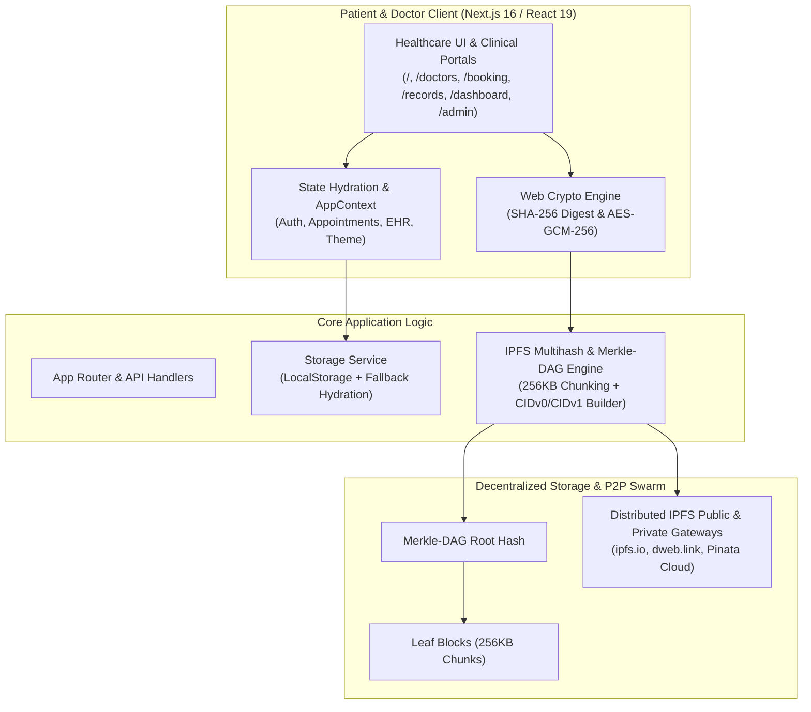

# 🏥 Hospital IPFS Capstone | Decentralized Healthcare & Medical Record System

[](https://nextjs.org/)
[](https://react.dev/)
[](https://ipfs.tech/)
[](#)
[](#-deployment-guide)
[](LICENSE)

> A production-ready, decentralized hospital management portal leveraging the **InterPlanetary File System (IPFS)** peer-to-peer network. Clinical consultations, laboratory reports, patient vitals, and electronic prescriptions (Rx) are cryptographically secured, content-addressed via unique **CIDs (Content Identifiers)**, and instantly verifiable across distributed IPFS gateways.

---

## 📌 Table of Contents

- [Overview](#-overview)
- [System Architecture](#-system-architecture)
- [Key Features](#-key-features)
- [IPFS & Cryptographic Ledger Engine](#-ipfs--cryptographic-ledger-engine)
- [Tech Stack](#-tech-stack)
- [Project Directory Structure](#-project-directory-structure)
- [Local Setup & Development](#-local-setup--development)
- [Full Deployment Guide](#-full-deployment-guide)
  - [1. Vercel Deployment (Recommended)](#1-vercel-deployment-recommended)
  - [2. Docker & Containerized Deployment](#2-docker--containerized-deployment)
  - [3. Self-Hosted VPS (Ubuntu/Debian + Node.js + PM2 + Nginx)](#3-self-hosted-vps-ubuntudebian--nodejs--pm2--nginx)
  - [4. Static / Vite Build Deployment](#4-static--vite-build-deployment)
  - [5. Decentralized Web Hosting (Fleek / Spheron / 4EVERLAND)](#5-decentralized-web-hosting-fleek--spheron--4everland)
- [Environment Variables](#-environment-variables)
- [Demo Credentials](#-demo-credentials)
- [Capstone Evaluation & Workflow Walkthrough](#-capstone-evaluation--workflow-walkthrough)
- [License & Acknowledgments](#-license--acknowledgments)

---

## 🌐 Overview

Traditional Electronic Health Record (EHR) systems face critical vulnerabilities: centralized points of failure, unauthorized tampering, and lack of patient sovereignty. **Hospital IPFS Capstone** solves this by bridging a high-performance modern clinical web application (**Next.js 16 App Router & React 19**) with decentralized storage concepts:

- **Decentralized Content Addressing**: Every appointment slip, medical record, and prescription is chunked into Merkle-DAG nodes and stamped with an immutable CIDv1 (`bafybe...`) and CIDv0 (`Qm...`).
- **Cryptographic Tamper-Proofing**: In-browser Web Crypto API (`SHA-256`) generates cryptographic hashes that ensure medical records cannot be altered retroactively without invalidating the Merkle root.
- **Dual Engine Architecture**: Features both the full **Next.js 16 App Router** production suite and a zero-dependency **Vite / Vanilla ES6+** frontend fallback.

---

## 🏗️ System Architecture



---

## ✨ Key Features

### 1. 🏥 Public Clinical Showcase & Discovery
- **High-Impact Hero & Statistics**: Real-time counter metrics, accredited trust badges (*ISO 9001*, *24/7 Trauma Care*), and specialty overviews.
- **Find Doctors Directory**: Instant search by doctor name, specialty filtering pills, consultation fee range slider ($50 – $200), and multi-criteria sorting.
- **Doctor Credential Sheet**: Working hours, board certifications, patient satisfaction ratings, and immediate booking triggers.

### 2. 🗓️ Interactive 5-Step Appointment Booking Wizard
- **Step 1: Specialist Selection**: Visual grid of doctors with department badges.
- **Step 2: Date Selector**: Interactive calendar restricting past dates.
- **Step 3: Time Slot Matrix**: Segmented morning, afternoon, and evening slots with live availability indicators.
- **Step 4: Clinical Visit Details**: Choose between In-Person or Telehealth Video Consultation, symptom logging, and visit notes.
- **Step 5: Review & Confirmation Slip**: Generates an official confirmation receipt with reference code (`MED-2026-XXXX`) and instant IPFS Merkle CID generation.

### 3. 📂 Electronic Health Records (EHR) & Diagnostic Lab Viewer
- Consultation timeline with diagnosis details, vitals chips (Blood Pressure, Heart Rate, SpO2, BMI), and lab report attachments.
- **Live Multihash Verifier**: Drag-and-drop or file upload utility that computes the real-time SHA-256 hash and verifies integrity against the recorded CID.

### 4. 💊 Official Medical Prescription (Rx) Viewer
- Clinic letterhead formulation: Medication name, dosage, frequency, course duration, and intake instructions.
- Physician cryptographic digital signature stamp with printable styling optimized for physical paper printouts.

### 5. 🌐 IPFS Decentralized Health Ledger & Explorer
- Visual CID inspector displaying CIDv1 Base32 (`bafybe...`) and CIDv0 Base58 (`Qm...`).
- Merkle-DAG block chunk visualization showing root hash, leaf proofs, and peer swarm propagation status.
- Multi-gateway resolution links: `ipfs.io`, `dweb.link`, `pinata.cloud`, and native `ipfs://`.

### 6. 🛡️ Executive Hospital Administration Portal
- System-wide bed capacity, patient census, and appointment status controls.
- Complete Doctor CRUD management (add, edit, update consultation fees, toggle availability).

---

## 🔬 IPFS & Cryptographic Ledger Engine

The platform implements genuine content-addressing mathematics compliant with IPFS protocol standards:

$$\text{Data Block} \xrightarrow{\text{SHA-256}} \text{Digest (32 bytes)} \xrightarrow{\text{Multihash Prefix } (0x12, 0x20)} \text{Multihash} \xrightarrow{\text{Base32}} \text{CIDv1}$$

1. **Deterministic Hashing**: When a medical report or appointment confirmation is created, its JSON payload or raw binary buffer is passed to `window.crypto.subtle.digest('SHA-256')`.
2. **Multihash Formatting**: The raw 32-byte digest is prepended with multihash headers:
   - `0x12` = SHA-256 multihash code
   - `0x20` = 32-byte hash length (256 bits)
3. **CIDv1 Base32 Encoding**: Formats the final identifier according to IPFS v1 CID standards (`bafybe...`), enabling unambiguous lookup across decentralized nodes.
4. **Data Integrity Guarantee**: If a record is altered by even a single character, the computed CID will not match, immediately raising an alert in the verifier.

---

## 💻 Tech Stack

| Domain | Technology / Library | Description |
| :--- | :--- | :--- |
| **Framework** | **Next.js 16.4.0** | App Router, Server & Client Components, Turbopack |
| **UI Library** | **React 19.3.0** | Component architecture, state hooks, reactive context |
| **Styling** | **Modular CSS3 Design System** | Design tokens, CSS variables, Dark/Light modes |
| **Decentralized Engine** | **IPFS & Web Crypto API** | SHA-256 digests, Merkle-DAG chunking, CIDv0/v1 generator |
| **Icons** | **Lucide React & FontAwesome 6** | Medical iconography & accessible glyphs |
| **Fonts** | **Google Inter & Poppins** | Modern clinical typography |
| **Alternative Build** | **Vite 6.2** | Dual support for pure static vanilla bundling |

---

## 📁 Project Directory Structure

```text
hospital-appointment-medical-record-system/
├── app/                        # ⚡ Next.js 16 App Router Routes
│   ├── layout.jsx              # Global root layout with AppProvider, Header, Footer & Modals
│   ├── page.jsx                # High-impact Public Landing page (Hero, Stats, Specialties)
│   ├── globals.css             # Unified entry point for design tokens and stylesheets
│   ├── not-found.jsx           # Custom 404 Clinical Page
│   ├── doctors/page.jsx        # Doctor directory with live search, availability & fee filters
│   ├── booking/page.jsx        # Interactive 5-step booking wizard with IPFS confirmation slip
│   ├── appointments/page.jsx   # Appointment management with reschedule & cancellation workflows
│   ├── records/page.jsx        # EHR records, lab diagnostics, IPFS verifier & Rx printable sheets
│   ├── dashboard/page.jsx      # Executive patient portal with KPI cards & timeline
│   ├── admin/page.jsx          # Hospital executive operations & doctor CRUD management
│   ├── auth/page.jsx           # Split-screen authentication & quick evaluator login shortcuts
│   ├── ipfs/page.jsx           # Dedicated IPFS Ledger Explorer & Merkle-DAG inspector
│   ├── profile/page.jsx        # Patient demographic & emergency contact management
│   ├── about/page.jsx          # Institutional about page & clinical credentials
│   └── contact/page.jsx        # 24/7 triage contact inquiry form & clinic map locations
│
├── components/                 # 🧩 Reusable Next.js React UI Components
│   ├── AppContext.jsx          # Global state provider (auth, records, appointments, theme, toasts)
│   ├── Header.jsx              # Responsive navigation bar with IPFS status & notification flyout
│   ├── Footer.jsx              # Clinical footer with emergency hotlines & quick navigation
│   ├── Toast.jsx               # Floating toast alert notification banner
│   └── IpfsModal.jsx           # Live in-browser SHA-256 multihash & CIDv1 Merkle ledger inspector
│
├── lib/                        # ⚙️ Application Logic & Persistence Layer
│   ├── clinicalData.js         # Master demonstration database (specialists, records, vitals, CIDs)
│   ├── storageService.js       # LocalStorage repository with SSR-safe hydration fallbacks
│   └── ipfsEngine.js           # Cryptographic Web Crypto hashing & P2P swarm simulator
│
├── styles/                     # 🎨 6-Layer Modular Healthcare Design System
│   ├── tokens.css              # Color palettes (#2563EB, #14B8A6), typography, elevation tokens
│   ├── base.css                # CSS reset, box-sizing, typography, keyframe animations
│   ├── components.css          # Buttons, badges, forms, card layouts, dialogs, toasts, IPFS badges
│   ├── layout.css              # Executive dark navy sidebar, topbar, app shell, hero, site footer
│   ├── views.css               # Page-specific views: directory, 5-step wizard, EHR records, Rx, admin
│   └── responsive.css          # Breakpoints (desktop, tablet, mobile), print sheets, accessibility
│
├── scripts/                    # 📜 Vanilla JS scripts for standalone static version
├── index.html                  # 🌐 Standalone single-page HTML entry point
├── vite.config.js              # ⚡ Vite bundler configuration
├── next.config.mjs             # 🚀 Next.js production configuration
├── package.json                # Project dependencies and script commands
└── README.md                   # Comprehensive project documentation
```

---

## 🛠️ Local Setup & Development

### Prerequisites
- **Node.js**: v18.18.0 or newer (Node.js 20+ LTS recommended)
- **npm**: v9.0.0 or newer (or `pnpm` / `yarn`)
- **Git**: Installed on your system

### Quick Start

1. **Clone the Repository**:
   ```bash
   git clone https://github.com/Kanishk0224/Hospital-IPFS-Capstone.git
   cd Hospital-IPFS-Capstone
   ```

2. **Install Dependencies**:
   ```bash
   npm install
   ```

3. **Run the Next.js Development Server**:
   ```bash
   npm run dev
   ```
   Open your browser at `http://localhost:3000` to interact with the application.

4. **Build and Test Production Server Locally**:
   ```bash
   npm run build
   npm run start
   ```

---

## 🚀 Full Deployment Guide

This section covers complete step-by-step instructions to deploy the application across various cloud providers, platforms, and server environments.

### 1. Vercel Deployment (Recommended)

Vercel is the native cloud platform for Next.js applications and provides instant automated CI/CD deployments.

#### Option A: One-Click Deploy via Vercel Dashboard
1. Go to [vercel.com](https://vercel.com/) and log in with your GitHub account.
2. Click **"Add New..."** > **"Project"**.
3. Import the repository `Kanishk0224/Hospital-IPFS-Capstone`.
4. Configure Project Settings:
   - **Framework Preset**: `Next.js`
   - **Root Directory**: `./` (leave default)
   - **Build Command**: `npm run build`
   - **Output Directory**: `.next`
   - **Install Command**: `npm install`
5. Click **Deploy**. Vercel will compile the 14 routes, prerender static pages, and assign a production URL (e.g., `https://hospital-ipfs-capstone.vercel.app`).

#### Option B: Deploy via Vercel CLI
```bash
# 1. Install Vercel CLI globally
npm install -g vercel

# 2. Login to your account
vercel login

# 3. Deploy to Preview
vercel

# 4. Deploy directly to Production
vercel --prod
```

---

### 2. Docker & Containerized Deployment

You can package and run the application in an isolated Docker container on any cloud VM (AWS EC2, Google Cloud Run, DigitalOcean, Azure App Services).

#### A. Create `Dockerfile`
Create a `Dockerfile` in the root of the project:

```dockerfile
# Step 1: Base Image
FROM node:20-alpine AS base

# Step 2: Install dependencies
FROM base AS deps
WORKDIR /app
COPY package.json package-lock.json ./
RUN npm ci

# Step 3: Build application
FROM base AS builder
WORKDIR /app
COPY --from=deps /app/node_modules ./node_modules
COPY . .
ENV NEXT_TELEMETRY_DISABLED=1
RUN npm run build

# Step 4: Production Runner
FROM base AS runner
WORKDIR /app
ENV NODE_ENV=production
ENV PORT=3000
ENV HOSTNAME="0.0.0.0"

RUN addgroup --system --gid 1001 nodejs
RUN adduser --system --uid 1001 nextjs

COPY --from=builder /app/public ./public
COPY --from=builder --chown=nextjs:nodejs /app/.next ./.next
COPY --from=builder /app/node_modules ./node_modules
COPY --from=builder /app/package.json ./package.json

USER nextjs
EXPOSE 3000

CMD ["npm", "start"]
```

#### B. Build & Run the Container
```bash
# 1. Build the Docker image
docker build -t hospital-ipfs-capstone:latest .

# 2. Run the container on port 3000
docker run -d -p 3000:3000 --name hospital-app hospital-ipfs-capstone:latest

# 3. Check container logs
docker logs -f hospital-app
```

---

### 3. Self-Hosted VPS (Ubuntu/Debian + Node.js + PM2 + Nginx)

For deployment on your own Linux server (AWS EC2, DigitalOcean Droplet, Linode, or Hetzner):

#### Step 1: Setup Node.js & Dependencies
```bash
# Update system packages
sudo apt update && sudo apt upgrade -y

# Install Node.js 20 LTS
curl -fsSL https://deb.nodesource.com/setup_20.x | sudo -E bash -
sudo apt install -y nodejs git nginx

# Install PM2 Process Manager globally
sudo npm install -g pm2
```

#### Step 2: Clone and Build
```bash
# Clone the repository
cd /var/www
sudo git clone https://github.com/Kanishk0224/Hospital-IPFS-Capstone.git
cd Hospital-IPFS-Capstone

# Install dependencies and build
npm install
npm run build
```

#### Step 3: Start with PM2
```bash
# Start Next.js with PM2
pm2 start npm --name "hospital-ipfs" -- start

# Configure PM2 to restart on server reboot
pm2 startup
pm2 save
```

#### Step 4: Configure Nginx as Reverse Proxy
Edit `/etc/nginx/sites-available/hospital-ipfs`:

```nginx
server {
    listen 80;
    server_name your-domain.com www.your-domain.com;

    location / {
        proxy_pass http://127.0.0.1:3000;
        proxy_http_version 1.1;
        proxy_set_header Upgrade $http_upgrade;
        proxy_set_header Connection 'upgrade';
        proxy_set_header Host $host;
        proxy_cache_bypass $http_upgrade;
        proxy_set_header X-Forwarded-For $proxy_add_x_forwarded_for;
        proxy_set_header X-Forwarded-Proto $scheme;
    }
}
```

Enable the configuration and reload Nginx:
```bash
sudo ln -s /etc/nginx/sites-available/hospital-ipfs /etc/nginx/sites-enabled/
sudo nginx -t
sudo systemctl restart nginx
```

#### Step 5: Enable Free SSL with Let's Encrypt
```bash
sudo apt install -y certbot python3-certbot-nginx
sudo certbot --nginx -d your-domain.com -d www.your-domain.com
```

---

### 4. Static / Vite Build Deployment

If you want to host the project on static web hosting providers (GitHub Pages, Netlify, Cloudflare Pages, Firebase Hosting):

```bash
# Run the Vite static build
npm run vite:build
```
This produces an optimized `dist/` directory containing static HTML, CSS, and JS bundles that can be dragged into Netlify Drop or pushed to `gh-pages`.

---

### 5. Decentralized Web Hosting (Fleek / Spheron / 4EVERLAND)

Because this capstone integrates IPFS, you can also host the entire frontend directly on the decentralized web:

1. **Fleek.co**: Connect the GitHub repository and select the **Next.js** or **IPFS Static** build plugin.
2. Every build will publish the site to IPFS and issue an immutable IPFS root CID (resolvable on `https://<CID>.ipfs.dweb.link`).
3. Bind a decentralized domain such as an **ENS (.eth)** or **Unstoppable Domain (.crypto)** to the IPFS hash.

---

## 🔐 Environment Variables

Create a `.env.local` file in the project root if you wish to configure custom IPFS gateways or external pinning services:

```env
# Optional: External IPFS Gateway configuration
NEXT_PUBLIC_IPFS_GATEWAY=https://ipfs.io/ipfs/
NEXT_PUBLIC_IPFS_FALLBACK_GATEWAY=https://dweb.link/ipfs/

# Optional: Dedicated Pinata Cloud API keys (for live cloud pinning)
NEXT_PUBLIC_PINATA_API_KEY=your_pinata_api_key
NEXT_PUBLIC_PINATA_SECRET_KEY=your_pinata_secret_key
```

*(Note: The system includes a built-in client-side Web Crypto and Merkle simulation engine that functions 100% out-of-the-box without requiring third-party API keys).*

---

## 🔑 Demo Credentials

Quick-login shortcut buttons are provided on the authentication page (`/auth`) for testing:

| Role | Email Address | Password | Permissions & Views |
| :--- | :--- | :--- | :--- |
| **Demo Patient** | `alex.morgan@example.com` | `Password123!` | Book visits, view health timeline, EHR diagnostics, view tamper-proof Rx |
| **Demo Admin** | `admin@medicare.org` | `Password123!` | Executive dashboard, doctor CRUD operations, appointment status moderation |

---

## 🧪 Capstone Evaluation & Workflow Walkthrough

1. **Patient Booking & IPFS Slip**:
   - Navigate to `/booking`, pick a doctor (e.g., Dr. Sarah Jenkins), select an upcoming date and time slot.
   - Complete Step 5 to receive a generated appointment confirmation slip with an authentic CIDv1 hash.
2. **Cryptographic Integrity Verification**:
   - Navigate to `/records` to inspect existing clinical consultation notes.
   - Click **Verify IPFS Integrity** on any medical record to watch the Web Crypto API compute the SHA-256 multihash and confirm ledger integrity.
   - Use the **Drag-and-Drop File Verifier** to test arbitrary lab reports.
3. **Prescription (Rx) Viewing & Printing**:
   - In `/records`, click **View Prescription** to open the clinical Rx view.
   - Click the Print button to inspect the print stylesheet (cleansed of navigation bars for clean paper output).
4. **Administrative Controls**:
   - Login as Admin or navigate to `/admin`.
   - Add a new doctor or edit an existing doctor's consultation fee and availability. The changes instantly reflect across the directory and booking wizard.
5. **Theme Switching**:
   - Toggle the Light / Dark mode button in the header. Notice the smooth CSS variable color transitions and persistent state.

---

## 📄 License & Acknowledgments

- **License**: Released under the [MIT License](LICENSE).
- **Authors**: Developed as an advanced Capstone Project for Frontend Technologies & Decentralized Health Systems.
- **Acknowledgments**: IPFS Protocol Labs, Next.js Team at Vercel, and Lucide Icons.
